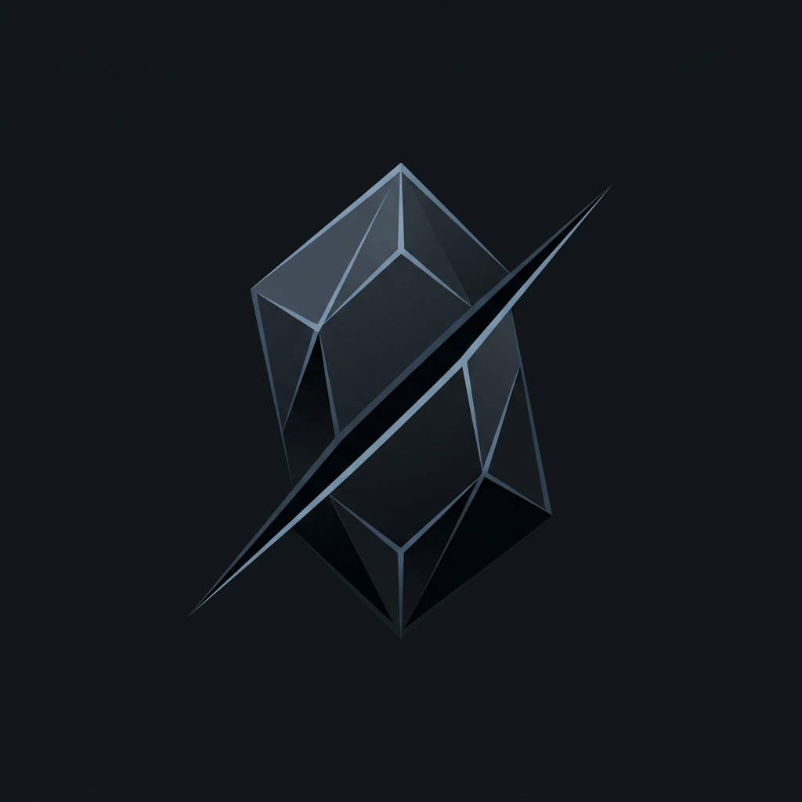

<div align="center">
  
  <h1>Obsidian Cut</h1>
  <p><strong>Lightweight, High-Performance Multi-Track Video, Slideshow & Audio Studio</strong></p>
  <p>Built with a <strong>Python + FFmpeg</strong> processing backend and a zero-bloat <strong>React + 2D Canvas</strong> NLE frontend — engineered for low-end hardware on <strong>Windows, WSL, and Linux</strong>.</p>
</div>

---

## Table of Contents

1. [Key Features](#key-features)
2. [Total Working & End-to-End Architecture](#total-working--end-to-end-architecture)
3. [Complete Step-by-Step Tutorials](#complete-step-by-step-tutorials)
4. [Advanced Studio Complete Guide (Fusion · Fairlight · MultiMaster · Transitions)](#advanced-studio-complete-guide-fusion--fairlight--multimaster--transitions)
5. [Tutorial References & Learning Index](#tutorial-references--learning-index)
6. [Batch Automation with `autoengine` (HJSON CLI)](#batch-automation-with-autoengine-hjson-wrapper)
7. [Keyboard & Mouse Shortcuts](#keyboard--mouse-shortcuts)
8. [Installation & Setup (Windows, WSL, Linux)](#installation--setup-windows-wsl-and-linux)
9. [API Endpoints Usage Guide](#api-endpoints-usage-guide)

---

## Key Features

- **Endless Workspace & Boundless Tracks**:
  - **Auto Sync Mode**: Upload photos, video clips, and music; automatically detects audio tempo (BPM) and beat timestamps in Python and assembles beat-synced slideshows with transitions and Ken Burns motion.
  - **Endless Workspace (Rough Cut)**: Zero-restriction rough-cut workspace featuring an auto-expanding horizontal timeline horizon, **Rough Cut** freeform toggle (unlocks snapping constraints), **Compact / Standard** layer heights, draggable vertical stack viewport (`190px–760px`), **Save / Load** project JSON, and 60-step **Undo/Redo** (`Ctrl+Z` / `Ctrl+Shift+Z`).
  - **Boundless Tracks**: Stack an unlimited number of **Overlay Layers** (`OL`), **Video Tracks** (`V`), and **Audio Tracks** (`A`) vertically, reorder compositing z-order (`▲`/`▼`), double-click to rename, lock layers during rough cuts, or drop media directly onto top/bottom auto-stack zones to spawn new layers instantly.
- **Music Layers, Waveform Draggers, Transitions & BGM Mixing**:
  - **On-Waveform Interactive Draggers**: Drag the yellow horizontal **Volume Rubber-Band** up/down directly on timeline audio clips (`0%–200%`), drag top-left/top-right emerald **Fade-In / Fade-Out Corner Handles** horizontally, and use per-track **Volume Faders** (`0%–150%`) right inside audio track headers.
  - **Incremental Volume Increasing & Decreasing (Envelope Graph)**: Double-click anywhere on an audio clip waveform (or in the Inspector's **Waveform Volume Curve**) to drop diamond **Envelope Nodes**, then drag nodes up/down and left/right to craft smooth crescendos, decrescendos, intro swells, and outro ducks—or apply 1-click presets (**Ramp Up**, **Ramp Down**, **Mid Dialogue Dip**).
  - **Background Music (BGM) Presets & Auto-Ducking**: 1-click mix targets (**Lead 100%**, **BGM 35%**, **Voice 18%**, **Boost 140%**) plus **Auto-Duck BGM** (`backgroundDucking` + `duckLevel`) that automatically lowers music volume whenever dialogue, voiceover, or video sound plays simultaneously—in both live preview and FFmpeg export.
  - **Music Cuts & Audio Transitions**: Razor-split music at playhead (`S` or **Cut @ Playhead**), **Loop / Repeat** segments seamlessly, pick **Fade Curve Shapes** (`S-Curve`, `Linear`, `Exponential`, `Logarithmic`), and click the emerald seam badge (`♪`) between adjacent music clips to apply **Equal-Power Crossfade**, **Linear Crossfade**, or **Dip & Swell** (`0.2s–4.0s`).
- **Advanced Mode (`Fusion · Fairlight · MultiMaster · Transitions`)**:
  - **Fusion VFX & Keyframe Animation Controller**: Node-based VFX graph, 3D particle systems, rotoscoping, camera tracker, Krokodove motion graphics, plus a **Keyframe Animation Controller & Visual Spline Graph Editor** (`Opacity`, `Scale`, `Position X`, `Position Y`, `Rotation` with `Linear`, `Ease In`, `Ease Out`, `Ease In/Out` curves exported directly to FFmpeg).
  - **Fairlight Audio Post-Production**: Folder-track submix buses, **Stereo L/R dBFS Audio Meters** with peak-hold & clipping indicators, **Audio Normalizer** (EBU R128 `-14` / `-16` / `-23` LUFS master & per-track `loudnorm` + 1-click clip peak auto-level), **Clip Crossfade Editor** (`Linear`, `Exponential`, `S-Curve` with waveform overlap preview & seam audition), parametric 3-band EQ, Dynamics Compressor/Limiter, VST plugin routing, and ADR cue recording.
  - **MultiMaster & 30-Effect Transition Library**: Precision timeline trimming (`Pointer`, `Ripple`, `Roll`, `Slip`, `Slide`), **Nested Timelines**, multi-camera sync, team **Power Bins & Smart Bins**, plus 30 video `xfade` transitions (`Fade`, `Dissolve`, `Wipe`, `Dip to Black/White`, directional wipes/slides, `Iris`, `Radial`, `Pixelize`, `Squeeze`).
- **Quick Render Page (Simpler & Faster In-Page Export)**:
  - Dedicated 4th top-level studio page (**Quick Render**) focused purely on fast exports directly inside the page—with 1-click speed/platform presets (`Lightning Draft 720p · Ultrafast`, `Fast YouTube 1080p`, `Vertical Reels 9:16`, `Square Social 1:1`), integrated **Audio Normalizer + Live Stereo L/R Level Check**, real-time FFmpeg progress & speed readout, and an embedded `<video>` player + direct Download button without modal clutter.
- **Live Audio Meters, Spectrum Visualizer & Normalizer Everywhere**:
  - Compact **Master Stereo L/R Peak/RMS dBFS Meter** and toggleable **RTA Spectrum** drawer inside the Preview transport bar, full 48-band **Real-Time Audio Spectrum Visualizer** (`Bars`, `Curve`, `Mirror` modes with peak-hold & logarithmic `36 Hz – 15.5 kHz` frequency scale powered by Web Audio `AnalyserNode` FFT + Fairlight EQ DSP) in **Fairlight Audio Studio**, compact **Master Audio Spectrum** in **Quick Render**, plus **Auto-Normalize Clip Level** and FFmpeg `loudnorm`.
- **Direct Canvas Resize/Crop, Chroma Key & Vector Titles**:
  - Drag corner handles on the live preview canvas to resize/scale overlays (`TL / TR / BL / BR / Full` presets), toggle **Crop** mode (`16:9`, `9:16`, `1:1`, `4:5`), apply Ken Burns motion, speed ramps (`0.25x–4.0x`), Reverse playback, and Chroma Key.
  - Design **Main Cinema Title**, **Lower Third**, **Subtitle**, **Vector Crest**, and **Scrolling Credits** with Sans/Display/Serif/Mono fonts and full `#RRGGBB` / `#RGB` color pickers.
- **Per-Picture & Master Color Grading Plug-in**:
  - Grade individual uploaded photos from the Media Bin (**Palette** icon) or Clip Inspector (`This Picture` scope) and **Sync to Timeline Clips**, or apply Master Timeline grades (`Teal & Orange`, `Warm Film`, `Mono Noir`, `Matte Fade`, `Vivid HDR`) with instant **Before/After (Compare)** bypass.

---

## Total Working & End-to-End Architecture

Obsidian Cut uses a split **Browser Preview + Background Python/FFmpeg Render** architecture so editing remains instant on modest CPUs while exports use full-precision native C/FFmpeg filters:

```
┌─────────────────────────────────────────────────────────────────────────────┐
│ 1. BROWSER FRONTEND (React 19 + TypeScript + HTML5 2D Canvas + Web/HTML5 A) │
│                                                                             │
│  MediaBin ──► TimelineEditor (Boundless Tracks + Waveform Envelope Draggers)│
│                     │                                                       │
│                     ├──► PreviewCanvas (Sandboxed 2D Canvas + Audio Sync)   │
│                     │     • Keyframes (evaluateClipTransformAtTime)         │
│                     │     • Audio Envelopes, Fade Curves, Auto-Duck & Xfade │
│                     │     • Crop Rectangles, Chroma Key & Color Grade LUTs  │
│                     └──► ClipInspectorPanel + Studio Tabs (Fusion/Fairlight)│
└───────────────────────────────┬─────────────────────────────────────────────┘
                                │ HTTP /api/* (Vite/Express Proxy: server.ts)
┌───────────────────────────────▼─────────────────────────────────────────────┐
│ 2. EXPRESS / NODE GATEWAY (server.ts — Port 3000)                           │
│  • Serves React UI + proxies /api/* uploads, range streams & render jobs    │
│  • Spawns & supervises Python backend (uvicorn FastAPI on internal port)    │
└───────────────────────────────┬─────────────────────────────────────────────┘
                                │ Local IPC (127.0.0.1:8001)
┌───────────────────────────────▼─────────────────────────────────────────────┐
│ 3. PYTHON NLE ENGINE (backend/engine.py)                                    │
│  a) Ingest & Smart Proxies (ffprobe + ffmpeg):                              │
│     • Probes codecs, dimensions, FPS/VFR flags (r_frame_rate vs avg)        │
│     • Generates 480p H.264 CFR video proxies & 1280px JPEG photo proxies    │
│     • Extracts 160-bin audio waveform peaks & BPM beat markers              │
│  b) Filter-Graph Compiler & Background Render Queue:                        │
│     • Composites bottom-to-top tracks with rational CFR setpts/fps timing   │
│     • Compiles Fusion keyframes -> FFmpeg eval=frame scale/rotate/geq/overlay│
│     • Compiles audio envelopes + backgroundDucking -> piecewise volume=eval │
│     • Applies afade curves (qsin/tri/exp/log), Fairlight EQ/comp & amix 48kHz│
│     • Streams progress polling (/api/render/:jobId) & final MP4/MOV/WebM DL │
└─────────────────────────────────────────────────────────────────────────────┘
```

### How Each Subsystem Works Together

1. **Media Ingest & Proxy Dual-Path**:
   - Original uploads are stored untouched in `.obsidiancut_data/uploads/`.
   - Large videos (`>540p`, VFR, HEVC/AV1/ProRes) get an `-g 15` intra-friendly H.264 editing proxy; audio files get an extracted 160-bar waveform amplitude array and BPM/beat timestamp array (`beats[]`).
   - During preview, the browser streams `/api/media/proxy/:id` with HTTP `206` Range requests and pre-warms upcoming clips `2.0s` ahead of the playhead. During final export, `backend/engine.py` reads the **full-resolution master** files.
2. **Real-Time Preview Evaluation (`src/utils/timelineMath.ts`)**:
   - At every animation frame `playhead`, `evaluateClipTransformAtTime()` interpolates Fusion `keyframes` (`opacity`, `scale`, `x`, `y`, `rotation`) with easing (`linear`, `easeIn`, `easeOut`, `easeInOut`).
   - Simultaneously, `evaluateAudioClipGain()` computes each music/audio clip's exact instantaneous gain by multiplying:
     `clipVolume/volumeEnvelope(t) × audioFadeCurve(fadeIn/fadeOut) × audioTransitionCrossfade × autoDuckMultiplier(foregroundActive) × trackVolume × folderBusVolume`.
3. **FFmpeg Export Compilation (`backend/engine.py`)**:
   - Every math function on the frontend has an exact counterpart in Python:
     - `build_keyframe_ff_expr()` converts keyframe spline nodes into nested FFmpeg `if(lte(...))` expressions evaluated per frame.
     - `build_audio_gain_filters()` converts `volumeEnvelope` points into piecewise linear `volume='...':eval=frame` expressions and injects `between(t, ov_s, ov_e)` attenuation whenever `backgroundDucking` is active under dialogue or foreground SFX/video tracks.
     - Adjacent audio clips with `audioTransitionOut` emit synchronized outgoing/incoming `afade` filters (`qsin` equal-power or `tri` linear) summed on a unified `48000 Hz` stereo clock via `amix`.

---

## Complete Step-by-Step Tutorials

You can also open the interactive **Tutorial** walkthrough from the top bar at any time inside the app (`src/components/TutorialModal.tsx`).

### Tutorial 1: Import Media & Smart Proxies
1. Drag & drop photos (`.jpg`, `.png`, `.webp`, `.gif`, `.bmp`, `.tiff`), videos (`.mp4`, `.mov`, `.mkv`, `.webm`, `.avi`), and songs (`.mp3`, `.wav`, `.aac`, `.m4a`, `.flac`, `.ogg`, `.opus`) into the **Media Bin**, or click **Load Sample Photos + 120 BPM** to test immediately.
2. Use the Media Bin search bar (appears automatically once you have more than 3 assets) to filter files by name.
3. Heavy 4K/VFR videos automatically generate lightweight editing proxies for smooth scrubbing while exports always use the full-resolution originals.

### Tutorial 2: Build Your Edit (Auto Sync vs. Endless Workspace & Boundless Tracks)
- **Auto Mode (Beat Sync)**: Pick a music track, set **Beat Sync Pace** (`Every Beat`, `Every 2 Beats`, `Every 4 Beats`, or `Fit Song`), choose a transition family, and click **Auto-Assemble**.
- **Endless Workspace (Boundless Tracks)**:
  - Stack unlimited vertical layers via **+ Overlay Layer**, **+ Video Track**, and **+ Audio Track**, or drop media onto the top/bottom drop strips to auto-create a new layer.
  - Reorder compositing z-order priority with **▲ / ▼**, double-click any layer name to rename, click **Lock** to protect tracks, and drag the bottom resize handle or toggle **Compact / Tall Stack**.
  - Enable **Rough Cut** for unrestricted freeform clip placement, drag clip edges to trim, press **`S`** to split, and use **Save** / **Load** to export or reopen `.json` projects.

### Tutorial 3: Music Layers — Waveforms, Volume Draggers, Ducking, Cuts & Transitions
1. **Track & Clip Level Controls**:
   - Drag the **Volume Fader** (`0%–150%`) right inside any Audio Track header to balance entire music vs. voiceover layers.
   - Or hover a music clip on the timeline and drag its yellow horizontal **Volume Rubber-Band** up/down (`0%–200%`), or pick a 1-click **Background Music Preset** (`Lead 100%`, `BGM 35%`, `Voice 18%`, `Boost 140%`) in the **Clip Inspector**.
2. **Incremental Volume Increasing & Decreasing on the Waveform**:
   - **On the Timeline**: Double-click anywhere along the yellow line inside an audio clip to insert a diamond **Volume Envelope Node**. Drag nodes **vertically** (`0%–200%`) and **horizontally** (`0%–100%` clip duration) to build smooth crescendos, swells, or dialogue dips. Right-click or `Shift + Click` any diamond to delete it.
   - **In the Clip Inspector**: Open **Music Layer & Volume Envelope**, double-click the interactive **Waveform Volume Curve** (or click **+ Point** at the current playhead), or click **↗ Ramp Up (Swell)**, **↘ Ramp Down (Outro)**, and **∿ Mid Dialogue Dip**.
3. **Fade Handles & Curve Shapes**:
   - Drag the top-left and top-right **emerald corner handles** directly on any audio clip horizontally to dial in **Fade In** and **Fade Out** durations—the waveform bars update live to reflect both fades and envelope ramps.
   - Choose a **Fade Curve Shape** (`S-Curve (Smooth)`, `Linear Ramp`, `Exponential Swell`, or `Logarithmic`) in the Inspector.
4. **Auto-Ducking Background Music Under Dialogue**:
   - Select your background music clip and check **Auto-Duck BGM**, then set **Duck Under Voice Level** (e.g., `25%–35%`). Whenever dialogue, video speech, or foreground SFX plays on another track, the BGM automatically lowers smoothly and returns afterward.
5. **Music Cuts & Crossfade Transitions**:
   - Scrub to a beat tick (gold markers on ruler) and press **`S`** (or **Cut @ Playhead**) to split a song cleanly, or click **Loop / Repeat** to extend a music bed.
   - Place two music clips back-to-back on an audio track and click the **`♪ Cut`** badge at the seam to select **Equal-Power Crossfade**, **Linear Crossfade**, or **Dip & Swell** (`0.2s–4.0s`).

### Tutorial 4: Video Transitions, Canvas Resize/Crop, Overlays & Chroma Key
1. Select any visual clip and pick from 30 transitions in **Transitions** (`Fade`, `Dissolve`, `Wipe`, `Dip to Black/White`, directional slides, `Iris`, `Pixelize`) with adjustable duration (`0.1s`–`2.5s`).
2. Drag corner handles directly on the Preview Canvas to resize overlays (`TL / TR / BL / BR / Full` presets), or switch the canvas tool to **Crop** for freeform/aspect cropping (`16:9`, `9:16`, `1:1`, `4:5`).
3. Click the **Layers** icon on any photo/video in the Media Bin to stack an overlay layer, then adjust Speed (`0.25x–4.0x`), Reverse playback, or **Chroma Key** green/blue-screen removal.

### Tutorial 5: Advanced Studio — Fusion Keyframes, Fairlight & MultiMaster
1. **Fusion VFX & Keyframe Graph Editor**: Switch to **Advanced Studio → Fusion**, select any clip, click **Add Keyframe (`◆`)** on `Opacity`, `Scale`, `Pos X`, `Pos Y`, or `Rotation` at multiple timestamps, and drag Bezier handles/curves (`Linear`, `Ease In`, `Ease Out`, `Ease In/Out`) inside the **Visual Graph Editor**. Combine with 3D Particle emitters, Rotoscoping, Camera Tracker, and Krokodove nodes.
2. **Fairlight Audio Post**: Manage folder-track submixes, dial in 3-band EQ, Compressor/Limiter, De-Esser, VST plugins, and ADR dialogue cue sheets.
3. **MultiMaster**: Trim across split edits, bundle tracks into **Nested Timelines**, sync multi-cam angles, and organize team **Power Bins** & **Smart Bins**.

### Tutorial 6: Vector Titles, Hex Colors & Per-Picture Color Grading
1. Open **Titles & Credits** in the Media Bin to insert `Main Cinema Title`, `Lower Third`, `Subtitle`, `Vector Crest`, or `Scrolling Credits` using Sans/Display/Serif/Mono fonts and exact `#RRGGBB` / `#RGB` hex colors.
2. Click the **Palette** icon on any photo in the Media Bin (or **Color Grade This Picture** in Clip Inspector) to grade individual pictures and sync across timeline clips, or switch to **Master Timeline** scope with **Compare (Bypass)** toggle.

### Tutorial 7: Quick Render Page, Audio Normalizer & Export HD
1. **Fast In-Page Export (`Quick Render`)**: Click **Quick Render** in the top navigation bar or mode switcher for a streamlined export-only workspace:
   - Choose a 1-click preset (**Lightning Draft 720p · Ultrafast**, **Fast YouTube 1080p**, **Vertical Reels 9:16**, or **Square Social 1:1**).
   - Enable **Audio Normalizer** (`-14 LUFS` YouTube/Web, `-16 LUFS` Social/Mobile, or `-23 LUFS` Broadcast EBU), scrub or play back to inspect the live **Master L/R Meter**, or click **Auto-Level All Audio Clips**.
   - Click **Start Fast Render** — watch live FFmpeg progress/speed (`e.g. 3.4x`), play back the finished video right inside the page, and click **Download Video File**.
2. **Modal Export from Any Workspace**: Click **Export HD** in the top-right bar from Auto Sync, Endless Workspace, or Advanced Studio to configure resolution (`720p`–`4K UHD`), CFR frame rate (`23.976`–`60`), container (`MP4`, `MOV`, `WebM`), encoder speed, and EBU R128 loudness normalization, then render in the background while continuing to edit.

---

## Advanced Studio Complete Guide (Fusion · Fairlight · MultiMaster · Transitions)

Switch to **Advanced Studio** (via the top nav or **Advanced Mode** switcher) to access the four professional post-production sub-studios:

### 1. Fusion — VFX, Motion Graphics & Keyframe Graph Editor
- **Keyframe Animation Controller & Visual Spline Graph Editor** (`src/components/KeyframeGraphEditor.tsx`):
  - Select any visual or title clip on the timeline and switch to **Fusion → Keyframe Graph**.
  - Scrub the playhead anywhere inside the clip, pick a parameter (**Opacity**, **Scale**, **Pos X**, **Pos Y**, **Rotation**), and click **+ Keyframe (`◆`)** at start/mid/end timestamps (or apply quick presets like **Zoom In**, **Slide Reveal**, **Ken Burns Drift**, **Spin Pop**).
  - Click between keyframe diamonds to choose easing curves (**Linear**, **Ease In**, **Ease Out**, **Ease In/Out**) and drag nodes visually on the spline chart. Keyframes evaluate smoothly in real time on the 2D Canvas and compile directly into per-frame FFmpeg expressions (`eval=frame` `scale`, `rotate`, `geq`, and `overlay`).
- **Node-Based VFX, 3D Particles, Rotoscoping, Camera Tracker & Krokodove**:
  - Enable **3D Particle Emitter** (`Embers`, `Snow`, `Stardust`, `Sparks`) with adjustable density & tint.
  - Enable **Rotoscoping Mask** and click points directly on the viewport frame to isolate or invert foreground subjects with adjustable feathering (`0–40 px`).
  - Run **Planar Camera Tracker** to lock motion offsets, or add **Krokodove Motion Graphics** (`HUD Rings`, `Kaleido Array`, `Glitch Slice`, `Extrude Grid`) and bake overlays cleanly to your timeline.

### 2. Fairlight — Audio Post-Production, Stereo Meters, Normalizer & Crossfades
- **Folder-Track Hierarchy & Multi-Track Console**:
  - Create **Folder Buses** (e.g., *Dialogue Bus*, *Music Stem*, *SFX Submix*) and assign child audio tracks (`A1`, `A2`, …) with independent **Solo (`S`)**, **Mute (`M`)**, and **Volume Faders**.
- **Stereo L/R Audio Meters (`AudioMeterBar.tsx`)**:
  - Every track channel strip and the **Master Bus** displays dual **L / R dBFS Peak/RMS meters** (`-48 dB` to `0 dB` green → amber → red scale) with white **peak-hold markers**, clipping warnings, and real-time **LUFS loudness readout** (also shown in compact form on the main Preview Canvas transport bar).
- **Audio Normalizer (3 Levels of Normalization)**:
  1. **Master Bus Loudness Normalizer**: Toggle **Normalizer ON** on the Master Bus strip (or in **Quick Render** / **Export HD**) and select **`-14 LUFS`** (YouTube/Streaming), **`-16 LUFS`** (Podcast/Mobile), or **`-23 LUFS`** (Broadcast EBU R128). Export runs FFmpeg `loudnorm=I=<target>:TP=-1.5:LRA=11` at unified `48 kHz` stereo.
  2. **Per-Track DSP `Norm`**: Select any track in Fairlight → **Channel EQ & Dynamics** → toggle **`Norm`** and pick the track's LUFS target so dialogue stems and music stems hit independent loudness ceilings before mixing.
  3. **Per-Clip Peak Auto-Level**: Click **Normalize All Clips** in Fairlight / Quick Render—or **Auto-Normalize Clip Level (-1.5 dB Peak)** in the Clip Inspector—to compute optimal clip `volume` from each waveform's analyzed peak/RMS profile.
- **Audio Clip Crossfade UI (`Mixer + Xfade` / `Crossfades` View)**:
  - Automatically detects overlapping and consecutive audio segments on every track.
  - Pick **Linear** (`tri`), **Exponential** (`exp`), or **S-Curve** (`hsin` smooth equal-blend), adjust **Crossfade Duration** (`0.10s–5.00s` slider, numeric input, or quick presets `0.25s / 0.75s / 1.50s / 3.00s`), click **Overlap Clips** to physically overlap segments cleanly, and click **Audition Seam** to preview right across the transition.
- **DSP Rack & ADR Dialogue Booth**:
  - Dial in **3-Band EQ** (`110 Hz` Low, `1.2 kHz` Mid, `6.5 kHz` High), **Compressor**, **Limiter**, **Reverb Send**, and **VST3 Plugin Inserts** (`Obsidian Comp-1176`, `Studio Param-EQ 4`, `Dialogue De-Esser Pro`, `ConvoVerb Scoring Hall`, `Warm Tape Saturator`, `Broadcast Limiter L2`).
  - Use the **ADR Booth** with 3-2-1 countdown, Cue In/Duration controls, microphone capture (with calibrated synthetic slate fallback in headless/sandbox environments), and 1-click **Commit to Track**.

### 3. MultiMaster — Precision Trimming, Nested Timelines & Team Bins
- **5 Trim Modes**: Switch seamlessly between **Pointer**, **Ripple** (auto-closes gaps), **Roll** (moves edit point between adjacent clips A & B), **Slip** (shifts source `trimStart` inside clip bounds), and **Slide** (repositions clip between neighbors).
- **Mark In / Mark Out (`I` / `O`) & Range Extract**: Mark a timeline range and run **Ripple Extract Range** to excise sections cleanly across tracks.
- **Nested Timelines & Multi-Camera Sync**: Bundle multi-track sections into reusable **Nested Sequences** (`Compound Clips`), load/manage sequences, and switch **Multi-Cam Angles** synchronized by timecode.
- **Power Bins & Smart Bins**: Save reusable team assets in **Power Bins** and auto-filter footage via rule-driven **Smart Bins** (e.g., *All Audio ≥ 110 BPM*, *VFR Footage*, *Color-Graded Shots*, *HD/4K Assets*).

### 4. Transition Library (30 FFmpeg `xfade` Transitions)
- Open **Advanced Studio → Transition Library** (or **Clip Inspector → Transitions**) to browse grouped transitions (**Core**, **Fade Variants**, **Wipe & Slide**, **Geometric & Stylized**, **Lens & Blur**) and apply to the selected clip or across all visual clips at once (`0.1s–1.8s`).

---

## Tutorial References & Learning Index

Use these built-in references inside the codebase to explore, customize, or automate every workflow:

| Topic / Feature Area | In-App Entry Point | Source / Documentation Reference |
| :--- | :--- | :--- |
| **Interactive Guided Tour (7 Steps)** | Top Bar → **Tutorial** button | [`src/components/TutorialModal.tsx`](src/components/TutorialModal.tsx) |
| **Quick Render (In-Page Fast Export)** | Top Bar / Mode Bar → **Quick Render** | [`src/components/QuickRenderPage.tsx`](src/components/QuickRenderPage.tsx) |
| **Stereo L/R Audio Meters & Normalizer** | Transport Bar, Fairlight Console & Quick Render | [`src/components/AudioMeterBar.tsx`](src/components/AudioMeterBar.tsx), [`src/utils/timelineMath.ts`](src/utils/timelineMath.ts) |
| **Music Layers, Waveforms, Envelopes & Ducking** | Timeline Audio Clips & Inspector → **Music Layer & Volume Envelope** | [`src/components/TimelineEditor.tsx`](src/components/TimelineEditor.tsx), [`src/components/ClipInspectorPanel.tsx`](src/components/ClipInspectorPanel.tsx) |
| **Endless Workspace & Boundless Tracks** | Mode Toggle → **Endless Workspace** | [`src/components/TimelineEditor.tsx`](src/components/TimelineEditor.tsx), [`src/App.tsx`](src/App.tsx) |
| **Fusion Keyframes & Visual Graph Editor** | Mode Toggle → **Advanced Studio → Fusion** | [`src/components/KeyframeGraphEditor.tsx`](src/components/KeyframeGraphEditor.tsx), [`src/components/FusionVfxStudio.tsx`](src/components/FusionVfxStudio.tsx) |
| **Fairlight Audio DSP, Crossfades, Buses & ADR** | Mode Toggle → **Advanced Studio → Fairlight** | [`src/components/FairlightAudioStudio.tsx`](src/components/FairlightAudioStudio.tsx) |
| **MultiMaster Trim, Nested Sequences & Bins** | Mode Toggle → **Advanced Studio → MultiMaster** | [`src/components/MultiMasterEditStudio.tsx`](src/components/MultiMasterEditStudio.tsx) |
| **Real-Time Canvas & Web Audio Compositor** | Center Viewport | [`src/components/PreviewCanvas.tsx`](src/components/PreviewCanvas.tsx) |
| **FFmpeg Filtergraph & Export Compiler** | **Quick Render** / **Export HD** Modal | [`backend/engine.py`](backend/engine.py), [`server.ts`](server.ts) |
| **Declarative HJSON Batch CLI** | Terminal CLI | [`autoengine/README.md`](autoengine/README.md), [`autoengine/examples/batch_videos.hjson`](autoengine/examples/batch_videos.hjson) |

---

## Batch Automation with `autoengine` (HJSON Wrapper)

Automate multiple video renders from a single declarative `.hjson` file using the standalone Python wrapper in [`autoengine/`](autoengine/README.md):

```bash
# Validate manifest & inspect clips
python -m autoengine validate autoengine/examples/batch_videos.hjson

# Dry-run timeline check without encoding
python -m autoengine run autoengine/examples/batch_videos.hjson --dry-run

# Render all videos in the HJSON manifest
python -m autoengine run autoengine/examples/batch_videos.hjson --report autoengine/output/batch_report.json
```

See [`autoengine/README.md`](autoengine/README.md) and [`autoengine/examples/batch_videos.hjson`](autoengine/examples/batch_videos.hjson) for the full schema and programmatic Python API.

---

## Keyboard & Mouse Shortcuts

| Shortcut | Action |
| :--- | :--- |
| `Space` | Play / Pause real-time preview |
| `,` or `Left Arrow` | Step back **1 exact frame** |
| `.` or `Right Arrow` | Step forward **1 exact frame** |
| `S` | Split / razor-cut selected clip at playhead |
| `Double-Click Audio Line` | Insert an incremental **Volume Envelope** diamond node |
| `Right-Click / Shift+Click Node` | Delete an audio volume envelope diamond node |
| `Ctrl + D` / `Cmd + D` | Duplicate / loop selected clip |
| `Ctrl + Z` / `Cmd + Z` | Undo edit (60-step bounded history) |
| `Ctrl + Shift + Z` / `Ctrl + Y` | Redo undone edit |
| `Delete` / `Backspace` | Delete selected clip (ripples when **Ripple** is active) |
| `Alt + Drag` / `Middle Drag` | Pan multi-track timeline horizontally & vertically |
| `Ctrl + Scroll` / `Cmd + Scroll` | Zoom timeline ruler in / out |

---

## Installation & Setup (Windows, WSL, and Linux)

### Prerequisites
- **Node.js** `20+` (or `22+`)
- **Python** `3.9+` (uses Python standard library only — **zero `pip install` packages required**)
- **FFmpeg & FFprobe** available on `PATH`

### 1. Install FFmpeg & Python
- **Windows (PowerShell / Winget)**:
  ```powershell
  winget install Gyan.FFmpeg Python.Python.3.12
  ```
  Restart your terminal so `ffmpeg`, `ffprobe`, and `python` (or `py -3`) are available on `PATH`.
- **WSL (Ubuntu / Debian) & Linux**:
  ```bash
  sudo apt update && sudo apt install -y ffmpeg python3 nodejs npm
  ```

### 2. Run Obsidian Cut
Quick-start with the bundled launcher script (installs dependencies automatically if missing):
```bash
./run.sh
```
Or run manually:
```bash
npm install
npm run dev
```
Open **`http://localhost:3000`** in your browser.

### Production Build
```bash
npm run build
npm run start
```

### Cross-Platform Notes
- `server.ts` automatically resolves Python across Windows (`PYTHON_BIN`, `python`, `py -3`, `python3`), WSL, and Linux, and handles both `SIGINT`/`SIGTERM` and Windows `SIGBREAK`.
- Workspace uploads, proxies, and rendered exports are stored locally in `.obsidiancut_data/` (override with `OBSIDIANCUT_DATA_DIR`).

---

## API Endpoints Usage Guide

All client and automation traffic goes through the Node/Express gateway on **`http://localhost:3000/api/*`**, which handles multipart uploads, HTTP `206 Partial Content` Range streaming, and local IPC proxying to the Python FFmpeg engine (`backend/engine.py`).

### Endpoint Summary

| Method | Endpoint | Description |
| :--- | :--- | :--- |
| `GET` | `/api/health` | Check Express gateway & Python FFmpeg engine readiness |
| `GET` | `/api/media` | List all imported media assets with dimensions, FPS, BPM & waveforms |
| `POST` | `/api/media/upload` | Upload up to 100 images, videos, or audio files (`multipart/form-data`, field `files`) |
| `PATCH` | `/api/media/:id/color-grade` | Persist per-picture color grading settings on an imported asset |
| `GET` | `/api/media/thumb/:id` | Fetch generated JPEG thumbnail for image/video assets |
| `GET` | `/api/media/proxy/:id` | Stream lightweight editing proxy (`480p` MP4 / `1280px` JPG / PNG / M4A) with Range support |
| `GET` | `/api/media/file/:id` | Stream original master upload with HTTP Range (`206 Partial Content`) |
| `POST` | `/api/audio/analyze` | Re-run BPM beat detection & 220-bin waveform extraction for an audio `assetId` |
| `POST` | `/api/sample-pack` | Populate the workspace with built-in HD sample photos + synthesized 120 BPM WAV |
| `DELETE` | `/api/media/:id` | Delete media asset, thumbnail, and proxy files from disk |
| `POST` | `/api/render` | Enqueue an asynchronous multi-track Python + FFmpeg render job (`202 Accepted`) |
| `GET` | `/api/render/:jobId` | Poll render status (`queued`, `rendering`, `completed`, `failed`), `%` progress & speed |
| `GET` | `/api/render/:jobId/download` | Download completed file (`?inline=1` streams with HTTP `206` Range for `<video>`) |

---

### 1. Health Check (`GET /api/health`)

```bash
curl -s http://localhost:3000/api/health
```
```json
{
  "ok": true,
  "node": true,
  "python": { "ok": true, "engine": "python-ffmpeg", "platform": "posix" }
}
```

### 2. Upload Media Files (`POST /api/media/upload`)

Send one or more media files using multipart field name **`files`** (max `100` files, `1 GB` per file). The Python engine automatically probes codecs, VFR/CFR frame rates, thumbnails, smart proxies, BPM, beat timestamps, and waveform bars.

```bash
curl -X POST http://localhost:3000/api/media/upload \
  -F "files=@./clip1.mp4" \
  -F "files=@./soundtrack.mp3"
```

```json
{
  "assets": [
    {
      "id": "a1b2c3d4e5f6",
      "name": "soundtrack.mp3",
      "mediaType": "audio",
      "duration": 16.0,
      "bpm": 120,
      "beats": [0.5, 1.0, 1.5],
      "waveform": [0.42, 0.88, 0.61],
      "fileUrl": "/api/media/file/a1b2c3d4e5f6"
    }
  ],
  "rejected": []
}
```

### 3. Load Built-In Sample Pack (`POST /api/sample-pack`) & List Assets (`GET /api/media`)

```bash
curl -X POST http://localhost:3000/api/sample-pack
curl -s http://localhost:3000/api/media
```

### 4. Persist Per-Picture Color Grade (`PATCH /api/media/:id/color-grade`)

```bash
curl -X PATCH http://localhost:3000/api/media/a1b2c3d4e5f6/color-grade \
  -H "Content-Type: application/json" \
  -d '{
    "colorGrade": {
      "enabled": true,
      "preset": "cinematic_teal",
      "exposure": 0.04,
      "contrast": 1.12,
      "saturation": 1.08,
      "gamma": 1.0,
      "temperature": -0.05,
      "tint": 0.02,
      "vignette": 0.25
    }
  }'
```

### 5. Re-Analyze Audio BPM & Waveform (`POST /api/audio/analyze`)

```bash
curl -X POST http://localhost:3000/api/audio/analyze \
  -H "Content-Type: application/json" \
  -d '{ "assetId": "a1b2c3d4e5f6" }'
```

### 6. Enqueue Multi-Track Render (`POST /api/render`)

Submit the full timeline JSON (`tracks`, `clips`, `colorGrade`, `export`) including Fairlight DSP (`normalizeEnabled`, `normalizeTargetLufs`), Fusion `keyframes`, audio `volumeEnvelope` ramps, `backgroundDucking`, `audioTransitionOut` crossfade curves, and Master `export.normalizeAudio`:

```bash
curl -X POST http://localhost:3000/api/render \
  -H "Content-Type: application/json" \
  -d '{
    "tracks": [
      { "id": "trk_v1", "name": "V1", "kind": "video", "muted": false, "solo": false, "hidden": false, "volume": 1 },
      {
        "id": "trk_a1",
        "name": "A1 Music",
        "kind": "audio",
        "muted": false,
        "solo": false,
        "hidden": false,
        "volume": 1,
        "audioDsp": {
          "eqLowDb": 0,
          "eqMidDb": 0,
          "eqHighDb": 1.5,
          "compressorEnabled": true,
          "limiterEnabled": true,
          "reverbMix": 0,
          "normalizeEnabled": true,
          "normalizeTargetLufs": -16,
          "vstSlots": []
        }
      }
    ],
    "clips": [
      {
        "id": "cl_v1",
        "trackId": "trk_v1",
        "kind": "image",
        "mediaId": "<IMAGE_ASSET_ID>",
        "startTime": 0,
        "duration": 4.0,
        "trimStart": 0,
        "fit": "cover",
        "scale": 1,
        "x": 0,
        "y": 0,
        "rotation": 0,
        "opacity": 1,
        "motion": "zoomIn",
        "transitionOut": "fade",
        "transitionDuration": 0.5,
        "fadeIn": 0,
        "fadeOut": 0,
        "speed": 1,
        "reverse": false,
        "muted": false,
        "volume": 1,
        "pan": 0,
        "effects": {}
      },
      {
        "id": "cl_a1",
        "trackId": "trk_a1",
        "kind": "audio",
        "mediaId": "<AUDIO_ASSET_ID>",
        "startTime": 0,
        "duration": 4.0,
        "trimStart": 0,
        "muted": false,
        "volume": 0.9,
        "pan": 0,
        "fadeIn": 0.3,
        "fadeOut": 0.6,
        "audioFadeCurve": "scurve",
        "audioTransitionOut": "crossfade_eq",
        "audioTransitionDuration": 1.0,
        "audioCrossfadeCurve": "scurve",
        "backgroundDucking": false,
        "speed": 1,
        "reverse": false
      }
    ],
    "colorGrade": { "enabled": false, "preset": "none", "exposure": 0, "contrast": 1, "saturation": 1, "gamma": 1, "temperature": 0, "tint": 0, "vignette": 0 },
    "export": {
      "resolution": "1920x1080",
      "fps": 30,
      "format": "mp4",
      "speedProfile": "veryfast",
      "autoDownload": true,
      "normalizeAudio": true,
      "normalizeTargetLufs": -14
    }
  }'
```
Response (`202 Accepted`):
```json
{ "jobId": "9f8e7d6c5b4a", "status": "queued" }
```

### 7. Poll Render Progress (`GET /api/render/:jobId`) & Download (`GET /api/render/:jobId/download`)

```bash
# Poll status until status == "completed"
curl -s http://localhost:3000/api/render/9f8e7d6c5b4a

# Download finished video to disk
curl -L -o output.mp4 http://localhost:3000/api/render/9f8e7d6c5b4a/download

# Or stream inline inside HTML5 <video> with HTTP 206 byte-range seeking
# http://localhost:3000/api/render/9f8e7d6c5b4a/download?inline=1
```

### End-to-End JavaScript (`fetch`) Automation Example

```ts
// 1. Enqueue render
const startRes = await fetch('http://localhost:3000/api/render', {
  method: 'POST',
  headers: { 'Content-Type': 'application/json' },
  body: JSON.stringify({ tracks, clips, colorGrade, export: { resolution: '1280x720', fps: 30, format: 'mp4', speedProfile: 'ultrafast', normalizeAudio: true, normalizeTargetLufs: -14 } }),
});
const { jobId } = await startRes.json();

// 2. Poll until completed
while (true) {
  const status = await (await fetch(`http://localhost:3000/api/render/${jobId}`)).json();
  if (status.status === 'completed') {
    console.log('Ready:', `http://localhost:3000/api/render/${jobId}/download`);
    break;
  }
  if (status.status === 'failed') throw new Error(status.error);
  await new Promise((r) => setTimeout(r, 700));
}
```
